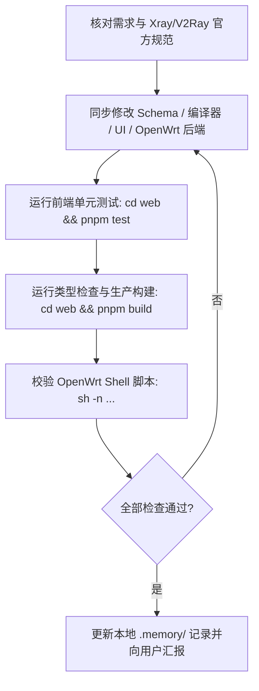

# AGENTS.md — luci-app-aios AI Agent Guidelines

本文档为所有在此代码库上工作的 AI Agent 提供指引与约束规范。在对项目进行任何修改前，请务必完整阅读并严格遵守以下准则。

---

## 1. 项目架构概述

- **双核统一架构（Xray-core & V2Ray）**：
  - 同一套 UCI 配置 `/etc/config/aios` 与 TypeScript/ucode 能力矩阵驱动 **Xray-core**（对齐 `Xray-docs-next`）与 **V2Ray / v2fly**（对齐 `v2fly-github-io`，同时支持 `jsonv4` 与 `jsonv5`）。
  - 保留全手动自由拼装任意 `inbounds` / `outbounds` / `dns` / `fakedns` / `routing` / `balancers` / `observatory` / `policy` / `reverse` 的模式，同时提供推荐设置快捷键与「将当前设置保存为预设」功能。
- **OpenWrt 单包结构（`packages/`）**：
  - `packages/luci-app-aios`：统一单包（`PKGARCH:=all`），含 `init.d/aios`、`rpcd/luci.aios`、双防火墙后端（fw4 独立表 `table inet aios` + fw3 独立 `AIOS_*` 链/ipset）、`ucode` 双核编译器（`gen_config.uc` + `adapter/{xray,v2ray,v2ray_v5}.mjs`）、Dnsmasq 多实例模板、完整 ACL 权限、LuCI 轻量入口壳（`entry.js`）及 Vite 独立后台产物（`/www/aios/`）。
- **独立后台前端（`web/`）**：
  - 基于 **Vite + TypeScript + Vue 3**，产物输出到 `packages/luci-app-aios/root/www/aios/`，由路由器 `uhttpd` 直接托管（零常驻进程），通过 `/ubus` + `rpcd/luci.aios` 与 `/etc/config/aios` 全量双向同步。
- **构建与验证入口**：
  - 前端测试、类型检查与构建：`cd web && pnpm test && pnpm build`
  - Shell 脚本语法校验：`sh -n packages/luci-app-aios/root/etc/init.d/aios packages/luci-app-aios/root/usr/libexec/rpcd/luci.aios packages/luci-app-aios/root/usr/share/aios/firewall/fw3_ipt.sh`
  - OpenWrt SDK 打包验证：`./scripts/verify-sdk.sh [x86-64-23.05.5|x86-64-25.12.6]` 及 GitHub Actions `.github/workflows/build.yml`

---

## 2. 核心铁律（强制执行）

### 铁律 1：类型检查、语法检查与打包验证（Typecheck, Syntax & Build Check）

- **要求**：任何对前端源码（`web/`）、测试（`tests/`）或 OpenWrt 后端脚本（`packages/`）的修改，必须在交付前通过严格类型检查、Shell 语法检查、单元测试与生产构建，确保 **0 编译错误、0 类型错误、0 语法错误**。
- **执行命令**：
  ```bash
  # 前端测试、严格类型检查与 Vite 构建
  cd web && pnpm test && pnpm build
  # OpenWrt Shell 脚本语法校验
  sh -n packages/luci-app-aios/root/etc/init.d/aios
  sh -n packages/luci-app-aios/root/usr/libexec/rpcd/luci.aios
  sh -n packages/luci-app-aios/root/usr/share/aios/firewall/fw3_ipt.sh
  ```
- **打包同步约束**：在 `packages/luci-app-aios/root/` 下新增或移动任何安装文件时，必须同步更新 `packages/luci-app-aios/Makefile` 的 `install` 段与 `PKG_VERSION`；新增 RPCD 方法时必须同步更新 `packages/luci-app-aios/root/usr/share/rpcd/acl.d/luci-app-aios.json`。

---

### 铁律 2：全维度命名空间隔离与新旧 OpenWrt 兼容

- **严禁占用公共或第三方插件资源**：
  - 所有配置、运行时文件、PID、Dnsmasq 片段统一限定在 `aios` 命名空间（`/etc/config/aios`、`/etc/aios/`、`/var/etc/aios/`、`/var/run/aios.main.pid`、`/tmp/dnsmasq[.inst].d/aios.conf`）。
  - 严禁使用 `pidof xray` / `pidof v2ray` / `killall` 影响宿主机独立运行的其他内核进程；必须通过 `procd` 与独立 `pidfile` 管理生命周期。
- **防火墙绝对隔离**：
  - **fw4 (nftables)**：所有规则必须位于独立 `table inet aios`，禁止直接往 `table inet fw4` 塞链或 flush 全局表，停服仅执行 `nft delete table inet aios`。
  - **fw3 (iptables + ipset)**：所有自定义链必须以 `AIOS_` 为前缀，所有 ipset 必须以 `aios_` 为前缀，清理时仅摘除 `AIOS_*` 链与 `aios_*` 集合。
  - 默认策略路由表（`166`）与高位 mark 区间（`0x3a01`–`0x3a0a`）必须在 UCI 中保持可配置，避开常见插件占用的 `table 100`/`251` 与低位 mark。
- **不放弃旧版 OpenWrt**：禁止在主包 `Makefile` 中将 `firewall4` 或单一内核设为不可取消的强制硬依赖；无 `ucode` 的旧版 OpenWrt 必须保持 `/etc/aios/compiled.json` 预编译配置启动链路可用。

---

### 铁律 3：双端同构与严格对齐官方文档（Xray-core & V2Ray）

- **Schema 严禁臆造与混用**：修改或新增 Xray / V2Ray 配置字段时，必须以对应官方文档中的真实字段名、嵌套层级、默认值与协议约束为准：
  - 严格隔离两核硬不兼容项（如 `expectedIPs` vs `expectIPs`、`domain` vs `domains`、`probeUrl` vs `probeURL`、`interface` vs `bindToDevice`、`tcpMptcp` vs `mptcp`、`hysteria` vs `hysteria2`、`metrics` 仅 Xray、`router`/`services` 仅 V2Ray jsonv5）。
  - 凡文档中类型为数组的字段，前端必须使用 `ArrayInput.vue`（或动态多行子列表组件）提供连续输入入口，且新增条目统一采用头部插入（`unshift`）。
- **TS / ucode / UCI 三处同步**：修改配置字段时必须同步更新：
  1. `web/src/schema/types.ts` 与 `web/src/schema/uci.ts`（UCI 全量双向序列化）；
  2. `web/src/compiler/`（TS 编译器）；
  3. `packages/luci-app-aios/root/usr/share/aios/`（ucode 编译器）。

---

### 铁律 4：必须通过非交互式自动化测试且严禁伪测试

- **要求**：所有双核编译逻辑（Xray / V2Ray jsonv4 / V2Ray jsonv5）、UCI 双向序列化、预设保存/Diff/应用、分享链接解析及防火墙规则预览/Diff 改动，必须运行 `cd web && pnpm test` 并 100% 通过。
- **严禁伪测试**：测试必须驱动真实生产模块并做实质性断言，禁止编写删掉核心逻辑仍能通过的空断言测试；每次修复 Bug 必须补充对应回归用例。
- **严禁硬编码真实环境敏感配置**：测试统一使用虚构域名、合成 UUID/密钥与测试 IP。

---

### 铁律 5：严禁未经允许擅自改变 Git 文件状态（No Unauthorized Git Add / Stage / Unstage / Commit）

- **核心禁令**：AI Agent **绝对禁止**在没有得到用户明确许可的情况下执行任何改变 Git 暂存区或提交历史的命令：
  1. **严禁擅自 Unstage**：禁止执行 `git restore --staged`、`git reset`、`git rm --cached` 触碰用户已暂存文件。
  2. **严禁擅自 Stage / Commit**：禁止未经用户明确授权自动执行 `git add` 或 `git commit`。
  3. **授权 Commit 时 Message 必须详尽（严禁单行敷衍提交）**：用户明确授权提交时，Commit Message **禁止仅写单行标题**，必须严格包含：
   - 规范标题行（`<type>(<scope>): <简明总结>`）；
   - 空行后的结构化分条正文，逐项写明：**变更背景/问题根因**、**按模块分条列举的具体改动点**（OpenWrt 后端/防火墙/RPCD/编译器/前端/CI/文档等）与**完整验证命令及结果**；
   - 严禁使用笼统措辞替代具体改动细节，确保 `git log` 独立可读、可追溯。

---

### 铁律 6：绝对禁止暂存或提交 `.memory/` 目录

- **要求**：`.memory/` 目录（包含调研报告、架构方案、长期记忆 `MEMORY.md` 与每日记录）仅用于本地上下文沉淀，**绝对禁止执行 `git add .memory/` 或将其提交至版本控制**。

---

### 铁律 7：绝对禁止自行启动或关闭系统服务

- **要求**：未经用户明确许可，禁止在宿主机或目标设备上自动启动、停止或重启常驻服务（如 `aios`、`xray`、`v2ray`、`dnsmasq`、`firewall`、`docker` 等）。

---

### 铁律 8：注释不得引用外部文件、不得写外部版本号、不得写日期

- **要求**：代码注释只描述协议、配置结构或逻辑事实本身，不得引用外部源码/抓包文件路径，不得在注释中写外部依赖版本号或日期，避免注释随外部演进而腐烂误导。

---

### 铁律 9：严禁为掩盖错误而写兜底逻辑（No Error-Masking Fallbacks）

- **要求**：禁止通过无故静默吞错、猜测默认值或掩盖上游缺陷来假装成功；遇到配置非法、依赖缺失或 RPC 失败时必须明确暴露可读错误与非零返回码（Fail Fast），并修复根因。

---

### 铁律 10：严禁参考用户未提供的旧 Debug 日志；连接中断立即汇报

- 排查问题时禁止参考用户未明确提供的历史临时日志。
- 若发生用户端连接中断，立即停止空转并输出当前进度等待指令。

---

## 3. 标准开发与提交流程



1. **需求与规范核对**：同步确认 Xray-core 与 V2Ray 对应字段及新旧 OpenWrt 防火墙/UCI 约束。
2. **三端一致修改**：同步维护 TS Schema/UCI 序列化、TS & ucode 编译器、Vue 3 表单与 `Makefile`/ACL。
3. **测试与构建**：执行 `cd web && pnpm test && pnpm build` 与 `sh -n` 校验，确保全部通过。
4. **记忆沉淀与汇报**：更新本地 `.memory/` 记录；保持工作区改动未暂存，向用户汇报改动细节并等待授权提交。
